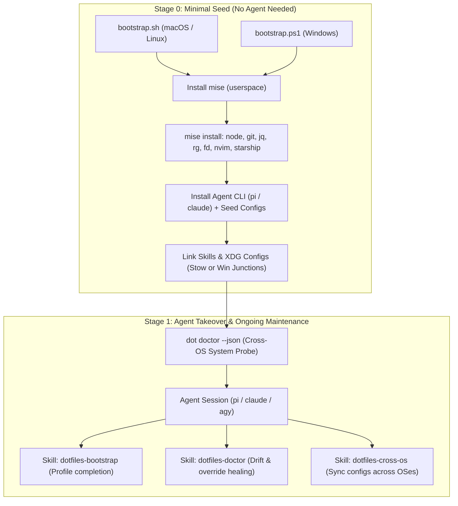

> **Historical document.** This is the plan the repository was built from, kept for reference
> and not maintained. What it proposed now lives, in its current form, in
> [`ADOPTION.md`](../ADOPTION.md) and [`DEPLOYMENT.md`](../DEPLOYMENT.md); where the two disagree,
> they are right.

# Agent-Managed Cross-OS Dotfiles Architecture Plan

## 1. Vision & Core Principles

Transform `~/dotfiles` from a collection of static shell scripts into an **Agent-Native, Cross-OS System** that works across:
1. **macOS Workstation** (Brew + Mise + Stow + AeroSpace/SketchyBar)
2. **Linux Desktop / Omarchy** (Pacman/Apt + Mise + Stow + Hyprland/i3)
3. **Headless Linux / Rootless SSH** (Mise userspace + Stow, zero `sudo` required)
4. **Native Windows Work Machine** (Windows Terminal + PowerShell 7 / Nushell + Mise + Junction/XDG Linker + Neovim + Starship + Pi)

---

## 2. Solving the Four Core Pain Points

### A. The "Chicken-and-Egg" Bootstrap Problem (Stage 0)
On a freshly installed machine (or locked-down corporate Windows laptop), there is no agent CLI, no Node/Python runtime, and no GNU Stow.
- **Solution:** Create two tiny, zero-dependency Stage 0 bootstrap scripts:
  - `bootstrap.sh` (POSIX/Bash for macOS & Linux)
  - `bootstrap.ps1` (PowerShell for native Windows)
- **What Stage 0 does (in <60 seconds, zero `sudo`/Admin required):**
  1. Ensures `mise` is installed in userspace (`~/.local/bin/mise` on Unix, `%LOCALAPPDATA%\mise` on Windows).
  2. Uses `mise` to install the universal portable baseline: `node@lts`, `git`, `ripgrep`, `fd`, `fzf`, `jq`, `neovim`, `starship`, `zig` (needed on Windows/rootless Linux so `nvim-treesitter` compiles parsers without Visual Studio / `gcc`).
  3. Installs `pi` (`@mariozechner/pi-coding-agent`) via `mise`'s Node `npm` so an agent is immediately callable.
  4. Seeds `~/.pi/agent/*.json` from templates (`init-pi-settings`) and links skills (`link-pi-agent-entries`).
  5. Drops the `dot` CLI wrapper into `~/.local/bin/dot` (and Windows `PATH`) and launches the agent (or prints the exact one-liner to authenticate and hand off to the agent).

---

### B. The Native Windows Problem (No Stow, Weird Paths, No Admin Symlinks)
Windows scatters configs across `%LOCALAPPDATA%`, `%APPDATA%`, and `Documents\PowerShell`, and blocks file symlinks unless Admin or Developer Mode is enabled.
- **Solution 1 — Force `$env:XDG_CONFIG_HOME = "$HOME\.config"` on Windows:**
  - Setting `XDG_CONFIG_HOME` at the User environment level on Windows makes **Neovim (`nvim`), Starship (`starship`), Bat (`bat`), Lazygit (`lazygit`), Yazi (`yazi`), and Ripgrep (`rg`)** all read directly from `C:\Users\<you>\.config\...`—matching macOS and Linux 1:1.
- **Solution 2 — Directory Junctions (`mklink /J`) for Zero-Admin Linking:**
  - Unlike file symlinks, **Windows Directory Junctions do not require Administrator privileges or Developer Mode**.
  - Our Windows linker (`scripts/windows/link-windows.ps1`) will link directory trees (`nvim-malo/.config/nvim-malo` $\rightarrow$ `~/.config/nvim` and `%LOCALAPPDATA%\nvim`, `nushell/.config/nushell` $\rightarrow$ `%APPDATA%\nushell`, `pi/.pi/agent/skills/*` $\rightarrow$ `~/.agents/skills/*` & `~/.pi/agent/skills/*`) using Junctions for directories and Hardlinks/Copies (with sentinel tracking) for standalone files (`starship.toml`, `WindowsTerminal\settings.json`, PowerShell `$PROFILE`).
- **Solution 3 — Dedicated `windows/` Package in Repo:**
  - Add a clean `windows/` folder containing:
    - `windows/windows-terminal/settings.json` (Catppuccin/TokyoNight theme, Nerd Font, keybindings matching your tmux/nvim habits, profiles for PowerShell 7, Nushell, and WSL).
    - `windows/powershell/Microsoft.PowerShell_profile.ps1` (sets `XDG_CONFIG_HOME`, initializes `mise`, `starship`, `zoxide`, aliases `vim`/`vi` to `nvim`, and exposes `dot`).

---

### C. Cross-OS & Convention Entropy (`scripts/doctor.sh` + `scripts/doctor.ps1`)
Instead of maintaining fragile bash `if/else` chains for every OS quirk, we give the agent a **single deterministic sensor**: `dot doctor [--json]`.
- Reports a structured JSON payload containing:
  - **Platform Context:** `os` (`macos` | `linux` | `windows`), `distro` (`omarchy` | `arch` | `debian` | `ubuntu` | `none`), `is_wsl`, `is_ssh`, `has_gui`, `has_sudo_or_admin`.
  - **Toolchain Health:** Status and versions of `mise`, `stow`, `nvim`, `starship`, `rg`, `fd`, `fzf`, `lazygit`, `tmux`, `pi`, `claude`.
  - **Config & Link Health:** Which dotfile packages are linked, missing, unfolded, or conflicted.
  - **Local Override / Drift Status:** Checks [`scripts/extract-local-overrides.sh`](file:///Users/mauro/dotfiles/scripts/extract-local-overrides.sh) sentinels (`# >>> END MANAGED CONFIG <<<`) and `git status` to detect untracked edits.

---

### D. Unifying All AI Agents (`pi`, `claude`, `.gemini` / Antigravity)
You already have an excellent non-pruning skill linker in [`scripts/link-pi-agent-entries.sh`](file:///Users/mauro/dotfiles/scripts/link-pi-agent-entries.sh) and safety rules in [`pi/.pi/agent/AGENTS.md`](file:///Users/mauro/dotfiles/pi/.pi/agent/AGENTS.md).
- **Root `AGENTS.md` + `CLAUDE.md` Sync:**
  - Update [CLAUDE.md](file:///Users/mauro/dotfiles/CLAUDE.md) and create a root `AGENTS.md` (so Pi, Claude Code, Codex, and Antigravity all read the exact same architectural contract when opened in `~/dotfiles`).
- **Extend Skill Linking:**
  - Keep [`scripts/link-pi-agent-entries.sh`](file:///Users/mauro/dotfiles/scripts/link-pi-agent-entries.sh) as the Unix linker (linking into `~/.agents/skills`, `~/.claude/skills`, `~/.pi/agent/skills`) and add an equivalent Windows Junction linker in `scripts/windows/link-windows.ps1` so all your skills (`review`, `diagnose`, `conventional-commit`, `rtfm`, etc.) work in `pi` and `claude` on Windows too.
- **Create the `dotfiles-maintainer` Skill (`pi/.pi/agent/skills/dotfiles-maintainer/SKILL.md`):**
  - A new harness-agnostic skill automatically linked to `~/.agents/skills` and `~/.claude/skills` that teaches any agent how to:
    1. Run `dot doctor --json` before making changes.
    2. Add/remove packages across [`Brewfile`](file:///Users/mauro/dotfiles/Brewfile), [`scripts/install/mise.sh`](file:///Users/mauro/dotfiles/scripts/install/mise.sh), [`scripts/install/manifest.sh`](file:///Users/mauro/dotfiles/scripts/install/manifest.sh), and Windows `mise`.
    3. Reconcile machine-local overrides using [`scripts/extract-local-overrides.sh`](file:///Users/mauro/dotfiles/scripts/extract-local-overrides.sh) and [`scripts/init-pi-settings.sh`](file:///Users/mauro/dotfiles/scripts/init-pi-settings.sh).
    4. Validate every change with [`scripts/validate-install.sh`](file:///Users/mauro/dotfiles/scripts/validate-install.sh).

---

## 3. Proposed File Changes & New Components

### Component 1: Stage 0 Bootstrap Scripts
- **`bootstrap.sh`** (new, repo root):
  - Minimal POSIX/Bash seed for macOS and Linux. Clones repo (if run via `curl`), bootstraps `mise`, installs core portable CLI + `pi`, runs `init-pi-settings.sh` and `link-pi-agent-entries.sh`, links `~/.local/bin/dot`, and hands off to the agent or `./install.sh`.
- **`bootstrap.ps1`** (new, repo root):
  - Minimal PowerShell seed for native Windows. Sets `XDG_CONFIG_HOME`, installs `mise`, installs portable tools (`node`, `nvim`, `starship`, `rg`, `fd`, `fzf`, `lazygit`, `zig`, `pi`), seeds `~/.pi/agent/*.json`, runs `scripts/windows/link-windows.ps1`, and sets up the `dot` command in PowerShell/Nushell.

### Component 2: Native Windows Package & Linker
- **`windows/powershell/Microsoft.PowerShell_profile.ps1`** (new):
  - Configures `$env:XDG_CONFIG_HOME = "$HOME\.config"`, activates `mise`, initializes `starship`, configures `PSReadLine` (vi-mode / history search), and defines `dot` + Neovim aliases.
- **`windows/windows-terminal/settings.json.template`** (new):
  - Clean Windows Terminal configuration template (Catppuccin Mocha / TokyoNight color schemes, Nerd Font defaults, `pwsh` / `nu` profiles, keybindings that don't clash with Neovim/Starship/Pi).
- **`scripts/windows/link-windows.ps1`** (new):
  - Zero-Admin Windows linker using Directory Junctions (`New-Item -ItemType Junction`) for `~/.config/nvim`, `%LOCALAPPDATA%\nvim`, `%APPDATA%\nushell`, `~/.pi/agent/extensions`, `~/.agents/skills`, `~/.claude/skills`, `~/.pi/agent/skills`, plus file linking/seeding for `starship.toml`, `.gitconfig`, PowerShell profile, and Windows Terminal settings.
- **`nvim-malo/` Windows Compatibility Polish**:
  - Audit `nvim-malo` for any hardcoded Unix assumptions (e.g., shell paths, clipboard, Mason/Treesitter compilers) and add clean `vim.fn.has("win32")` guards so `nvim-malo` starts with zero errors inside Windows Terminal.

### Component 3: Universal `dot` CLI & System Doctor
- **`scripts/doctor.sh`** (new) & **`scripts/windows/doctor.ps1`** (new):
  - Cross-OS health, capability, symlink, and drift inspector supporting both human-readable output and `--json` for LLM agents.
- **`local-bin/.local/bin/dot`** (new, stowed to `~/.local/bin/dot`):
  - Universal entrypoint supporting:
    - `dot doctor [--json]` — Inspect machine state & config drift
    - `dot bootstrap` — Run Stage 0 seed
    - `dot sync` / `dot link` — Re-link stow packages + agent skills + extract local overrides
    - `dot validate` — Run [`scripts/validate-install.sh`](file:///Users/mauro/dotfiles/scripts/validate-install.sh)
    - `dot agent [prompt...]` — Launch `pi` or `claude` in `~/dotfiles` with `dot doctor --json` context automatically attached.

### Component 4: Agent Brain & Skills
- **`AGENTS.md`** (new at root) & **[`CLAUDE.md`](file:///Users/mauro/dotfiles/CLAUDE.md)** (updated):
  - Unified documentation covering the 4 target environments (macOS, Linux/Omarchy, Headless SSH, Native Windows), the manifest architecture, sentinel override rules, and safety guardrails.
- **`pi/.pi/agent/skills/dotfiles-maintainer/SKILL.md`** (new):
  - Actionable skill teaching any agent (`pi`, `claude`, `agy`) how to bootstrap, diagnose, add tools, manage cross-OS configs, and heal drift in this repo.

---

## 4. Verification Plan

1. **Existing Installer Regression Suite:**
   - Run `./scripts/validate-install.sh` and `./scripts/validate-manifest.sh` to verify zero regressions in the existing macOS/Linux installer.
2. **Doctor & CLI Verification:**
   - Run `./local-bin/.local/bin/dot doctor` and `./local-bin/.local/bin/dot doctor --json | jq .` on this macOS machine to verify accurate detection of OS, tools, stow symlinks, and sentinel overrides.
3. **Skill Linker Verification:**
   - Run `./scripts/link-pi-agent-entries.sh --dry-run` and `--list` to verify the new `dotfiles-maintainer` skill links cleanly into `~/.agents/skills` and `~/.claude/skills`.
4. **Neovim Cross-OS Check:**
   - Verify `nvim-malo` headless startup (`NVIM_APPNAME=nvim-malo nvim --headless +qa`) passes cleanly with the Windows compatibility guards in place.
